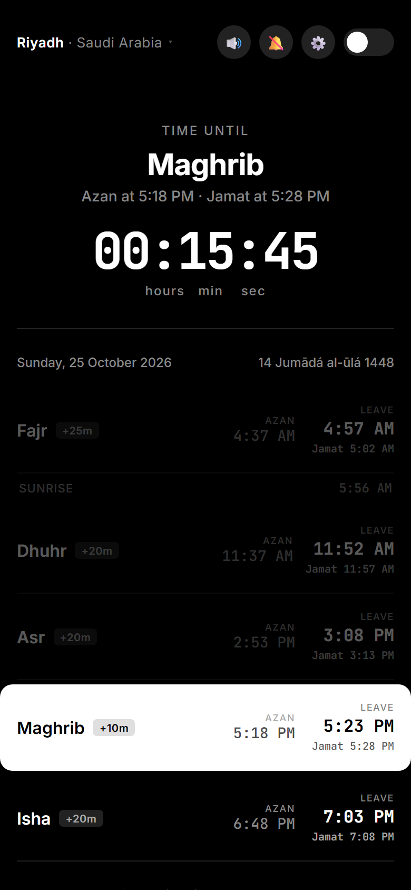
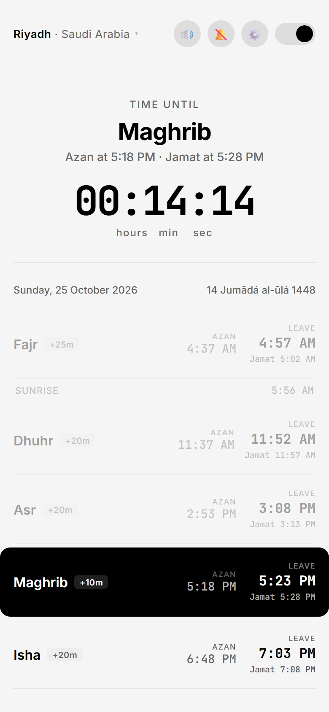
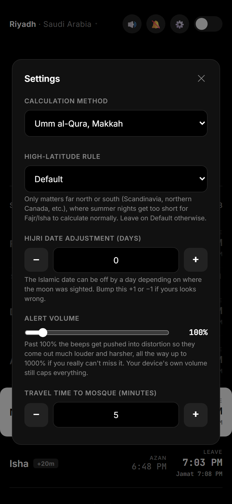

# Namaz Times

A minimal, installable prayer times app. It counts down to the next azan and jamat, tells you when to leave for the mosque, works offline, and remembers everything you set.

**[Open the live app →](https://ibrahimahtsham.github.io/namaz-times/)**


<p align="center">
  
  &nbsp;
  
  &nbsp;
  
</p>

## Features

- **Live countdown** to the next azan, switching to "leave by" once a prayer window is active.
- **Jamat and leave-by times.** Set the gap between azan and jamat for each prayer and your travel time to the mosque, and the app tells you exactly when to leave.
- **Location.** Search any city, or use your device's location (with reverse geocoding).
- **11 calculation methods:** Umm al-Qura, ISNA, MWL, Karachi, Egyptian, Gulf, Kuwait, Qatar, Singapore, Turkey (Diyanet) and Moonsighting Committee.
- **Alerts.** A synthesized tone (no audio files) plus an optional browser notification when azan time hits.
- **Installable and offline.** Add it to your home screen or install it as a desktop app. A service worker caches the app and the last prayer times, so it keeps working with no connection.
- **Dark and light themes.** Every preference (location, method, offsets, travel time, theme, notifications) is saved in `localStorage`.

## How it's built

Everything is one dependency-free `index.html`: plain HTML, CSS and JS, with no build step and no framework.

- Prayer times come from the [Al Adhan API](https://aladhan.com/prayer-times-api).
- City search uses the [Open-Meteo geocoding API](https://open-meteo.com/en/docs/geocoding-api). "Use my location" uses the browser Geolocation API plus [BigDataCloud](https://www.bigdatacloud.com/) reverse geocoding.
- `manifest.json` and a hand-written service worker (`sw.js`) make it installable and offline-capable: cache-first for static files, network-first with a cache fallback for pages.
- `gen-icons.js` generates the app icons from scratch. It writes valid PNG files byte by byte (chunk framing, a hand-rolled CRC32, zlib deflate for the pixels) with no image library. Run `node gen-icons.js` to regenerate them.

## Run it locally

Serve the folder over HTTP (service workers need a real origin, not `file://`):

```bash
npx serve .
```

Then open the URL it prints.
